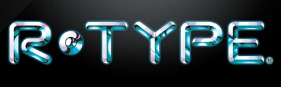

# R-Type

R-type is an advanced C++ project. The goal of the project is to recreate the infamous arcade game of the same name, moreover, it must be a multiplayer game. Up to 4 players can join a party and beat ennemies and bosses together.

## Project Description

If we go deeper, the aim of the project is to create a server and a client, that communicates to create a fluid game. Our R-type is based on our own Game Engine, uses Asio for the netwroking and the Raylib for the graphical aspect. Clients as well as the server are multi-threaded, which create a smooth experience as different handling are done asynchronously.

For now, our server can only handle one lobby at a time, we long to implement a server that can handle multiple session at the same time. Moreover, we want to diversify our bestiary and create more accessibility features to allow our game to be playable by everyone.

We also aim for our game to soon be Cross-Plateform. For now, the program lauches on Linux and Mac and should be available to Windows in the upcoming weeks.

> [!NOTE]
> The game can already played through a game controler to fit for people with motor disabilities

## Installation

Run these two commands in order from the project root to compile it:

```bash
cmake -P build.cmake
```

```bash
cmake --build build
```

If you want to clean the directory, run this command:

```bash
cmake -P build/clean.cmake
```

## Usage

**Launch the Server**

```sh
./rtype_server [port] --difficulty [difficultyMode]
```
> [!NOTE]
> difficultyMode can be 'easy', 'medium', or 'hard' (it is set to medium by default)

**Launch Clients**

```sh
./rtype_client [host ip] [port]
```

> [!NOTE]
> The server and client must be launched on the same port

### Controls

Only the player can be controlled with the following keys

Key         | Action
------------|-----------
Up Arrow    | Go Up
Down Arrow  | Go Down
Left Arrow  | Go Left
Right Arrow | Go Right
Space       | Shoot

# Documentation

[Server Documentation](src/network/README.md)<br>
[Game Documentation](src/games/README.md)<br>
[Game Engine Documentation](src/ecs/README.md)

## Authors

* **Yanis Harkouk** * - [@Yanis Harkouk](https://github.com/yanishk)
* **Mathis Brehm** * - [@Mathis Brehm](https://github.com/mathisbdkr)
* **Wilson Bordichon** * - [@Wilson Bordichon](https://github.com/Wilson-Epitech)
* **Eva Legrand** * - [@Eva Legrand](https://github.com/Chaegnal)
* **Edouard Bocquet** * - [@Edouard Bocquet](https://github.com/edouardclm)


