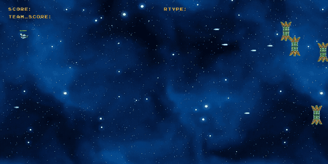
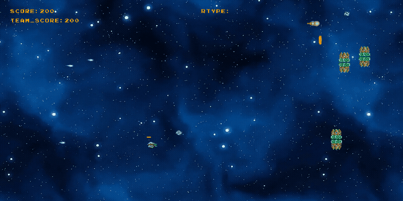

<div align="center">

# R-Type

**Le shoot'em up culte, en multijoueur réseau, sur un moteur de jeu maison.**

     

<sub>Projet à 5 · 2024</sub>

</div>

<br/>

<p align="center"></p>

## Le projet en quelques mots

On a recréé *R-Type* à cinq, en partant de zéro. Le gros du travail, c'est le **moteur** : une architecture ECS générique et une couche réseau client / serveur, sur lesquelles le jeu est construit. Jusqu'à 4 joueurs jouent ensemble contre des vagues d'ennemis et des boss.

## Ce que ça fait

- **Moteur ECS** (Entity Component System) : registry, composants et systèmes, indépendants du jeu
- **Multijoueur** client / serveur en UDP avec Asio, jusqu'à 4 joueurs
- Plusieurs niveaux, des boss, des power-ups, un score individuel et un score d'équipe
- Difficulté et tir allié configurables au lancement du serveur
- Build **multiplateforme** : Linux, macOS et Windows (MinGW)
- CI qui compile le projet sur Linux et macOS à chaque push

<p align="center"></p>
<p align="center"><sub>Une vague d'ennemis, avec le score d'équipe</sub></p>

## Lancer le projet

```bash
cmake -P build.cmake            # installe vcpkg + raylib/asio/glfw puis configure
cmake --build build
./rtype_server 4242 --difficulty medium --friendlyfire false
./rtype_client 127.0.0.1 4242   # ← flèches pour bouger, espace pour tirer
```

La documentation technique complète est dans [DOCUMENTATION.md](DOCUMENTATION.md).

## L'équipe

<a href="https://github.com/Wilson-Epitech/r-type/graphs/contributors"></a>

Yanis Harkouk, Mathis Brehm, Eva Legrand, Wilson Bordichon, Edouard Bocquet

**Ma partition :** Je me suis occupé du **système de build multiplateforme** (CMake, intégration vcpkg, scripts de build Linux / macOS, build Windows avec MinGW) et de la **CI GitHub Actions**. J'ai aussi travaillé sur des composants ECS et sur le gameplay.
